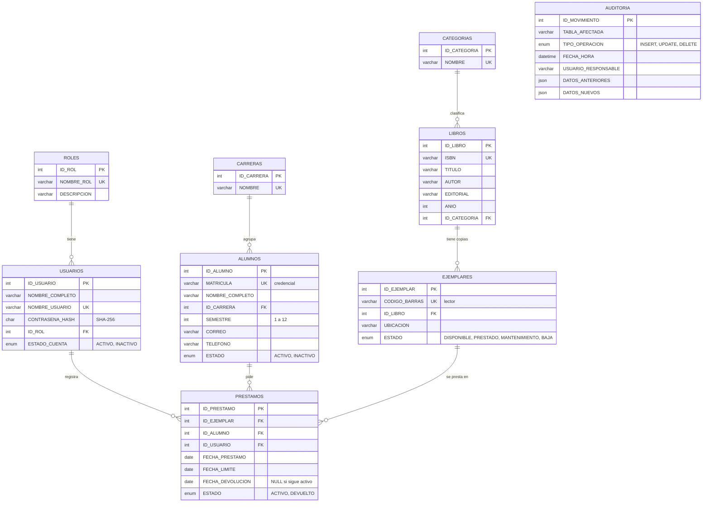

# Modelo de datos

Base de datos `BIBLIOTECA` en MySQL 8 (juego de caracteres `utf8mb4`, intercalación `utf8mb4_0900_ai_ci`). Script de creación: [`01_estructura.sql`](../src/Logic/Sql_Schema/EstructuraPorPartes/01_estructura.sql).

## 1. Entidades

| Entidad | Qué representa |
| --- | --- |
| ROLES | Tipo de usuario del sistema (administrador, bibliotecario, consulta). |
| USUARIOS | Personal que inicia sesión en la aplicación. |
| CARRERAS | Carreras de la institución a las que pertenecen los alumnos. |
| ALUMNOS | Estudiantes que piden libros prestados (no inician sesión). |
| CATEGORIAS | Clasificación temática de los libros. |
| LIBROS | La obra: título, autor, ISBN. Un libro puede tener varias copias. |
| EJEMPLARES | Cada copia física de un libro, con su propio código de barras. |
| PRESTAMOS | Préstamo de un ejemplar a un alumno, registrado por un usuario. |
| AUDITORIA | Bitácora de cambios que escriben los triggers. |

La distinción entre **LIBROS** y **EJEMPLARES** es la decisión central del diseño. El código de barras identifica la copia física, no la obra: así se sabe exactamente qué copia tiene cada alumno, dónde está cada una y en qué estado se encuentra.

## 2. Diagrama entidad-relación

La misma figura como imagen, para el documento impreso: [`diagrama-er.png`](diagrama-er.png).

**Cardinalidades**

| Relación | Cardinalidad | Lectura |
| --- | --- | --- |
| ROLES – USUARIOS | 1 : N | Un rol lo tienen muchos usuarios; cada usuario tiene exactamente un rol. |
| CARRERAS – ALUMNOS | 1 : N | Una carrera tiene muchos alumnos; cada alumno pertenece a una carrera. |
| CATEGORIAS – LIBROS | 1 : N | Una categoría agrupa muchos libros; cada libro tiene una categoría. |
| LIBROS – EJEMPLARES | 1 : N | Un libro tiene una o más copias; cada copia es de un solo libro. |
| EJEMPLARES – PRESTAMOS | 1 : N | Una copia se presta muchas veces en su vida, pero tiene **a lo más un préstamo activo** a la vez (lo garantiza el estado PRESTADO y `TRG_VAL_PRESTAMOS_BI`). |
| ALUMNOS – PRESTAMOS | 1 : N | Un alumno puede tener muchos préstamos, con **máximo 3 activos** (`TRG_VAL_PRESTAMOS_BI`). |
| USUARIOS – PRESTAMOS | 1 : N | Cada préstamo guarda qué usuario lo registró. |

`PRESTAMOS` relaciona a un alumno con un ejemplar en el tiempo (con fechas y estado) y resuelve la relación muchos a muchos entre ALUMNOS y EJEMPLARES. `AUDITORIA` no tiene llaves foráneas a propósito: debe conservar el registro aunque la fila original se borre (por ejemplo, un libro eliminado).

## 3. Modelo relacional

Notación: `PK` = llave primaria, `FK →` = llave foránea (tabla a la que apunta), `UK` = valor único.

- **ROLES** (`ID_ROL` PK, `NOMBRE_ROL` UK, `DESCRIPCION`)
- **USUARIOS** (`ID_USUARIO` PK, `NOMBRE_COMPLETO`, `NOMBRE_USUARIO` UK, `CONTRASENA_HASH`, `ID_ROL` FK → ROLES, `ESTADO_CUENTA`)
- **CARRERAS** (`ID_CARRERA` PK, `NOMBRE` UK)
- **ALUMNOS** (`ID_ALUMNO` PK, `MATRICULA` UK, `NOMBRE_COMPLETO`, `ID_CARRERA` FK → CARRERAS, `SEMESTRE`, `CORREO`, `TELEFONO`, `ESTADO`)
- **CATEGORIAS** (`ID_CATEGORIA` PK, `NOMBRE` UK)
- **LIBROS** (`ID_LIBRO` PK, `ISBN` UK, `TITULO`, `AUTOR`, `EDITORIAL`, `ANIO`, `ID_CATEGORIA` FK → CATEGORIAS)
- **EJEMPLARES** (`ID_EJEMPLAR` PK, `CODIGO_BARRAS` UK, `ID_LIBRO` FK → LIBROS, `UBICACION`, `ESTADO`)
- **PRESTAMOS** (`ID_PRESTAMO` PK, `ID_EJEMPLAR` FK → EJEMPLARES, `ID_ALUMNO` FK → ALUMNOS, `ID_USUARIO` FK → USUARIOS, `FECHA_PRESTAMO`, `FECHA_LIMITE`, `FECHA_DEVOLUCION`, `ESTADO`)
- **AUDITORIA** (`ID_MOVIMIENTO` PK, `TABLA_AFECTADA`, `TIPO_OPERACION`, `FECHA_HORA`, `USUARIO_RESPONSABLE`, `DATOS_ANTERIORES`, `DATOS_NUEVOS`)

**Normalización.** El esquema está en tercera forma normal:
- **1FN:** todos los atributos son atómicos y no hay grupos repetidos; las copias de un libro son filas de EJEMPLARES, no columnas en LIBROS.
- **2FN:** todas las llaves primarias son de una sola columna, así que no hay dependencias parciales.
- **3FN:** no hay dependencias transitivas. El nombre de la carrera, de la categoría y del rol viven en su propia tabla y se referencian por id; los datos del libro no se repiten en cada ejemplar.
- **Datos que no se guardan, se calculan.** La disponibilidad de un libro y los días de retraso no se guardan, para que nunca queden desactualizados: se obtienen con `FN_DISPONIBLES_LIBRO` y `FN_DIAS_RETRASO`.

## 4. Diccionario de datos

### ROLES
| Columna | Tipo | Nulo | Llave | Restricciones | Descripción |
| --- | --- | --- | --- | --- | --- |
| ID_ROL | INT | No | PK | AUTO_INCREMENT | Identificador del rol. |
| NOMBRE_ROL | VARCHAR(30) | No | UK | UNIQUE | ADMINISTRADOR, BIBLIOTECARIO o CONSULTA. Debe coincidir con los perfiles de `config.py`. |
| DESCRIPCION | VARCHAR(100) | Sí | | | Qué puede hacer el rol. |

### USUARIOS
| Columna | Tipo | Nulo | Llave | Restricciones | Descripción |
| --- | --- | --- | --- | --- | --- |
| ID_USUARIO | INT | No | PK | AUTO_INCREMENT | Identificador del usuario. |
| NOMBRE_COMPLETO | VARCHAR(100) | No | | | Nombre de la persona. |
| NOMBRE_USUARIO | VARCHAR(30) | No | UK | UNIQUE | Con el que inicia sesión (sin espacios, en mayúsculas). |
| CONTRASENA_HASH | CHAR(64) | No | | | SHA-256 en hexadecimal; nunca se guarda la contraseña en texto plano. |
| ID_ROL | INT | No | FK | → ROLES(ID_ROL) | Rol del usuario. |
| ESTADO_CUENTA | ENUM('ACTIVO','INACTIVO') | No | | DEFAULT 'ACTIVO' | Una cuenta inactiva no puede iniciar sesión (`SP_LOGIN`). |

### CARRERAS
| Columna | Tipo | Nulo | Llave | Restricciones | Descripción |
| --- | --- | --- | --- | --- | --- |
| ID_CARRERA | INT | No | PK | AUTO_INCREMENT | Identificador de la carrera. |
| NOMBRE | VARCHAR(80) | No | UK | UNIQUE | Nombre de la carrera. |

### ALUMNOS
| Columna | Tipo | Nulo | Llave | Restricciones | Descripción |
| --- | --- | --- | --- | --- | --- |
| ID_ALUMNO | INT | No | PK | AUTO_INCREMENT | Identificador interno. |
| MATRICULA | VARCHAR(20) | No | UK | UNIQUE | Número de control; viene en el código de barras de la credencial. |
| NOMBRE_COMPLETO | VARCHAR(100) | No | | | Nombre del alumno. |
| ID_CARRERA | INT | No | FK | → CARRERAS(ID_CARRERA) | Carrera que estudia. |
| SEMESTRE | INT | No | | CHECK (1 a 12) | Semestre que cursa. |
| CORREO | VARCHAR(100) | Sí | | La app valida el formato | Para avisarle de retrasos. |
| TELEFONO | VARCHAR(15) | Sí | | La app valida que sean dígitos | Teléfono de contacto. |
| ESTADO | ENUM('ACTIVO','INACTIVO') | No | | DEFAULT 'ACTIVO' | Un alumno inactivo no puede pedir libros (`TRG_VAL_PRESTAMOS_BI`). |

### CATEGORIAS
| Columna | Tipo | Nulo | Llave | Restricciones | Descripción |
| --- | --- | --- | --- | --- | --- |
| ID_CATEGORIA | INT | No | PK | AUTO_INCREMENT | Identificador de la categoría. |
| NOMBRE | VARCHAR(50) | No | UK | UNIQUE | Nombre de la categoría. |

### LIBROS
| Columna | Tipo | Nulo | Llave | Restricciones | Descripción |
| --- | --- | --- | --- | --- | --- |
| ID_LIBRO | INT | No | PK | AUTO_INCREMENT | Identificador del libro. |
| ISBN | VARCHAR(20) | No | UK | UNIQUE | ISBN de la obra (se puede escanear de la contraportada). |
| TITULO | VARCHAR(150) | No | | | Título. |
| AUTOR | VARCHAR(100) | No | | | Autor principal. |
| EDITORIAL | VARCHAR(80) | Sí | | | Editorial. |
| ANIO | INT | Sí | | CHECK (NULL o > 0) | Año de publicación. |
| ID_CATEGORIA | INT | No | FK | → CATEGORIAS(ID_CATEGORIA) | Categoría del libro. |

### EJEMPLARES
| Columna | Tipo | Nulo | Llave | Restricciones | Descripción |
| --- | --- | --- | --- | --- | --- |
| ID_EJEMPLAR | INT | No | PK | AUTO_INCREMENT | Identificador interno de la copia. |
| CODIGO_BARRAS | VARCHAR(30) | No | UK | UNIQUE · CHECK (no vacío) · `TRG_VAL_EJEMPLARES_BI/BU` | Etiqueta pegada en la copia; es lo que lee el lector. |
| ID_LIBRO | INT | No | FK | → LIBROS(ID_LIBRO) | Libro al que pertenece la copia. |
| UBICACION | VARCHAR(50) | No | | | Pasillo y estante. Sus cambios quedan en la auditoría (`TRG_AUD_EJEMPLARES_AU`). |
| ESTADO | ENUM('DISPONIBLE','PRESTADO','MANTENIMIENTO','BAJA') | No | | DEFAULT 'DISPONIBLE' | Solo un ejemplar DISPONIBLE se puede prestar. PRESTADO lo ponen los procedimientos de préstamo y devolución. |

### PRESTAMOS
| Columna | Tipo | Nulo | Llave | Restricciones | Descripción |
| --- | --- | --- | --- | --- | --- |
| ID_PRESTAMO | INT | No | PK | AUTO_INCREMENT | Identificador del préstamo. |
| ID_EJEMPLAR | INT | No | FK | → EJEMPLARES(ID_EJEMPLAR) | Copia prestada. |
| ID_ALUMNO | INT | No | FK | → ALUMNOS(ID_ALUMNO) | Alumno que la lleva. |
| ID_USUARIO | INT | No | FK | → USUARIOS(ID_USUARIO) | Usuario que registró el préstamo. |
| FECHA_PRESTAMO | DATE | No | | | Día del préstamo (`CURDATE()` en el procedimiento). |
| FECHA_LIMITE | DATE | No | | CHECK (≥ FECHA_PRESTAMO) | Día en que debe devolverse (7 días por omisión). |
| FECHA_DEVOLUCION | DATE | Sí | | `TRG_VAL_PRESTAMOS_BU`: no antes del préstamo | Día en que se devolvió; NULL mientras está activo. |
| ESTADO | ENUM('ACTIVO','DEVUELTO') | No | | DEFAULT 'ACTIVO' · un préstamo DEVUELTO ya no se modifica | Situación del préstamo. Vencido = ACTIVO con FECHA_LIMITE < hoy. |

### AUDITORIA
| Columna | Tipo | Nulo | Llave | Restricciones | Descripción |
| --- | --- | --- | --- | --- | --- |
| ID_MOVIMIENTO | INT | No | PK | AUTO_INCREMENT | Identificador del movimiento. |
| TABLA_AFECTADA | VARCHAR(30) | No | | | EJEMPLARES, PRESTAMOS, LIBROS, ALUMNOS o USUARIOS. |
| TIPO_OPERACION | ENUM('INSERT','UPDATE','DELETE') | No | | | Operación que disparó el trigger. |
| FECHA_HORA | DATETIME | No | | DEFAULT CURRENT_TIMESTAMP | Cuándo ocurrió. |
| USUARIO_RESPONSABLE | VARCHAR(100) | No | | | Usuario de la aplicación (`@USUARIO_APP`), o el usuario de MySQL (`USER()`) si el cambio se hizo fuera de la app. |
| DATOS_ANTERIORES | JSON | Sí | | | Valores antes del cambio (UPDATE y DELETE). |
| DATOS_NUEVOS | JSON | Sí | | | Valores después del cambio (INSERT y UPDATE). |

## 5. Restricciones de integridad

| Tipo | Dónde | Qué evita |
| --- | --- | --- |
| Llave primaria | Las 9 tablas (`AUTO_INCREMENT`) | Filas repetidas o sin identificar. |
| Llave foránea | USUARIOS, ALUMNOS, LIBROS, EJEMPLARES, PRESTAMOS | Referencias a registros que no existen; borrar un libro que tiene copias o una carrera con alumnos. |
| UNIQUE | `CODIGO_BARRAS`, `ISBN`, `MATRICULA`, `NOMBRE_USUARIO` y los nombres de rol, carrera y categoría | Códigos de barras duplicados (requisito del lector) y otros datos repetidos. |
| CHECK | `SEMESTRE` 1–12, `ANIO` > 0, `FECHA_LIMITE` ≥ `FECHA_PRESTAMO`, `CODIGO_BARRAS` no vacío | Valores fuera de rango. |
| ENUM + DEFAULT | Estados de usuarios, alumnos, ejemplares, préstamos y auditoría | Estados inventados. |
| NOT NULL | Datos obligatorios | Registros incompletos. |
| Triggers de validación | `TRG_VAL_EJEMPLARES_BI/BU`, `TRG_VAL_PRESTAMOS_BI/BU` | Código vacío, prestar un ejemplar no disponible, prestar a un alumno inactivo o con 3 préstamos, modificar un préstamo ya devuelto, devolución con fecha anterior al préstamo. |
| Transacciones | `SP_REGISTRAR_PRESTAMO`, `SP_REGISTRAR_DEVOLUCION` | Que el préstamo quede guardado sin cambiar el estado del ejemplar, o al revés. |
